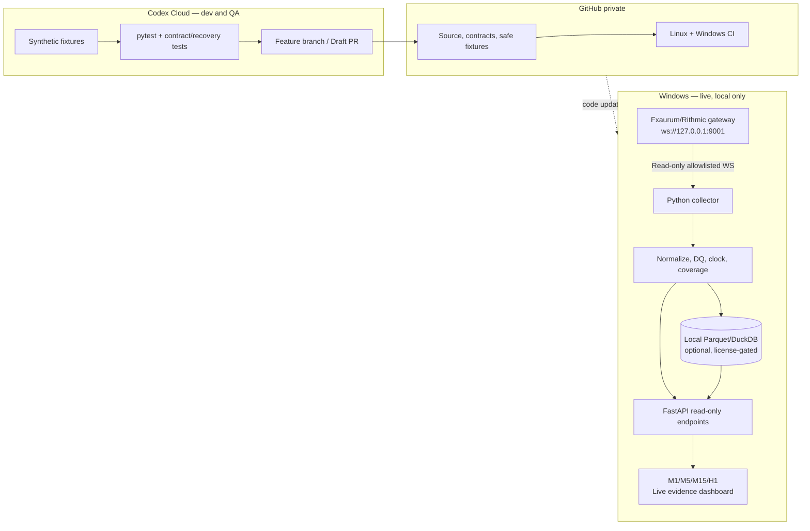

# GC Live Observatory — Codex Cloud Implementation Playbook

**Edition:** 2026-11-19 · **Starting state:** starter v0.1 described by owner; ZIP not available for file-by-file inspection in this session · **Target:** bounded, auditable v0.2.

## 0. Decision and evidence ledger

The immediate engineering question is: **Can we observe COMEX GC trades and BBO on a local Windows machine, preserve their temporal/provenance semantics, and safely evolve a reproducible synthetic-cloud development workflow without exposing the unauthenticated trading-capable Fxaurum gateway?**

- **FACT (vendor docs):** Fxaurum API.md declares a single unauthenticated WebSocket at `ws://127.0.0.1:9001/`, UTC timestamps, `SUBSCRIBE`, `@trade`, `@bookTicker`, `@depthraw`, `@mboraw`, `mboProbe` and read-only RPCs. Latest version shown when inspected: **1.13.5** (2026-09-14 release notes).
- **FACT (vendor docs):** Client WebSocket reconnect requires `SUBSCRIBE` again; gateway-to-Rithmic upstream auto-reconnect restores active subscriptions on the surviving socket. These are distinct failure modes.
- **FACT (vendor docs):** `@depthraw` provides `Reset`, `Image`, `Update`, `Delete`, generation/sequence and a `depthSnap` recovery RPC. `@mboraw` carries gateway-sequenced `Fill` events; `src=0` exact passive-ID join, `src=1` inferred fallback, and these classes must not be conflated.
- **FACT (Codex docs):** Codex Cloud uses published environments and isolated task workspaces. A task does not share the user's Windows localhost.
- **UNKNOWN:** ZIP's actual files/test count, Windows collector status, GC entitlement, actual Rithmic connection, market-data license and CI runs. Never convert the owner's previous description into fresh test evidence.
- **UNKNOWN:** `nam28386/gc-live-observatory` was unavailable (404) through the connected GitHub account at inspection. It may be uncreated or the connection may lack access. Do not claim it definitely does not exist.

Sources:
- https://github.com/fxaurum/rithmic-api-docs/blob/main/API.md
- https://github.com/fxaurum/rithmic-api-docs/blob/main/MBO.md
- https://learn.chatgpt.com/docs/cloud
- https://learn.chatgpt.com/docs/environments/cloud-environments
- https://help.openai.com/en/articles/20001545-using-codex-cloud

## 1. Target deployment diagram



**Production data boundary:** No live Rithmic stream, capture, broker account credentials, trading RPC, or unlicensed market data in Codex Cloud or GitHub. GitHub stores code, synthetic fixtures and non-sensitive evidence only. No VPN tunnel, ngrok, reverse proxy or remote socket exposure to gateway port 9001.

## 2. Local GitHub import (once, on Windows)

1. Create `nam28386/gc-live-observatory` as a **private** repository on https://github.com/new. If the source is new, leave initialization unchecked.
2. Expand `gc-live-observatory-starter-v0.1.zip` to `C:\Projects\gc-live-observatory`; if a wrapper folder was produced, change to the directory containing `requirements.txt`, `docs` and the application package.
3. Audit `.gitignore` and tracked files before committing; NEVER commit `.env`, tokens, account material, real capture, `.db`/Parquet market files, or logs.
4. If this is not already a Git checkout, run:

```powershell
Set-Location C:\Projects\gc-live-observatory
git init -b main
git remote add origin https://github.com/nam28386/gc-live-observatory.git
git add .
git status --short
git diff --cached --stat
# Only after reviewing staged files for secrets and licensed data:
git commit -m "chore: import GC Live Observatory v0.1 starter"
git push -u origin main
```

Do not run `git init` or `git remote add` again if the checkout already has Git metadata. If there is already a populated remote, inspect history first and avoid forced pushes.

### Recommended ignore entries (append only when applicable)

```gitignore
.venv/
__pycache__/
.pytest_cache/
.env
.env.*
!.env.example
*.log
captures/
data/live/
data/raw/
*.parquet
*.duckdb
*.sqlite
*.db
```

Review any existing fixtures: a file called `test_fixture.json` is not automatically synthetic.

## 3. Configure Codex Cloud environment (web)

1. In ChatGPT/Codex, choose **Work in > Cloud**, then **Select environment > Create environment**.
2. Connect GitHub if prompted and select `nam28386/gc-live-observatory`. If absent, review the GitHub installation/repository access for Codex, not just GitHub login.
3. Choose **Get started**, request Python 3.12 and the repo dependencies, and let Codex prepare and test the setup.
4. Use only synthetic fixtures; give the environment no market data login, broker secret or gateway tunnel. Limit internet access to needed package registries/documentation.
5. Review setup output. Only **Publish** after `pwd`, `git status`, dependency installation and basic tests can execute. New tasks each get an isolated workspace.
6. Start a separate task for each PR, always using a feature branch from `main` and recording actual commit SHA and tests.

**Setup request to paste:**

```text
Prepare this repository as a reusable Codex Cloud development environment.
Runtime: Python 3.12. Install project dependencies from the repository manifest, initially requirements.txt if it exists.
Inspect the actual repo structure before choosing commands.
Run and record: pwd; git status --short --branch; python --version; python -m pip check; python -m pytest -q.
Use synthetic fixtures only. Do not attempt to reach Windows localhost or Rithmic.
No secrets, live orders, account RPCs, gateway tunnels or production deployment.
If bootstrap or workspace command execution fails, stop and report WORKSPACE_BOOT_FAILURE with the exact failing command.
Report verified PASS/FAIL/UNVERIFIED separately, then publish only when environment setup truly succeeded.
```

## 4. Initial repo contracts (adapt to existing files; do not overwrite blindly)

```text
AGENTS.md                               # Small map: goals, constraints, how to run tests
README.md
requirements.txt
observatory/                            # Preserve existing package/module paths
contracts/
  market_event.schema.json
  instrument_registry.yaml
  data_quality.yaml
docs/
  ARCHITECTURE.md                       # Existing source of truth, review before edits
  GATEWAY_API_CONTRACT.md
  MEASUREMENT_INTEGRITY.md
  THREAT_MODEL.md
  CODEX_PROMPTS.md
  EVIDENCE_GATES.md
tests/
  fixtures/synthetic/
  unit/
  integration/
  recovery/
  temporal/
  security/
.github/workflows/
```

This is a **logical** structure, not an instruction to move working code merely to match a tree. `AGENTS.md` should be a short index pointing to these versioned docs, not a duplicate of all contracts.

### Canonical market event contract

Every normalized record should preserve, when the vendor supplies it:

| Field | Contract |
|---|---|
| `source_id`, `source_doc_version` | `fxaurum_rithmic` plus doc/protocol version pinned to source commit |
| `exchange`, `symbol`, `contract_metadata` | Explicit `COMEX`/`GC<expiry>`; don't silently assume the CME exchange code from ES examples |
| `channel`, `event_type`, `source_event_id` | `trade`, `bookTicker`, `depthraw`, `mboraw`; keep exact source event metadata |
| `source_ts_ms`, `source_tu_us`, `source_tn_ns` | Separate source clocks and nullable precision; never coerce microseconds to milliseconds without documenting truncation |
| `gateway_receive_ms` | `r` on `@trade` or `gw` where provided; nullable on other types |
| `collector_receive_utc_ns`, `collector_monotonic_ns` | Local wall time and monotonic clock for arrival ordering, do not use monotonic as UTC |
| `gen`, `seq`, `coverage_id` | Required when the stream provides them; distinguish generations |
| `price_tick`, `size_contracts`, `side` | Decimal/integer tick units; signed trade side B/S/UNKNOWN; no guessed side for unknown |
| `quality_flags`, `availability_time` | Explicit STALE/GAP/OUT_OF_ORDER/RECOVERING/UNENTITLED etc.; no silent forward fill |
| `raw_ref`, `schema_version`, `git_sha` | Provenance and build lineage; only actual recorded SHA, never fabricated |

`@trade`: `T` is ms; `tu` is the matching-event time in µs; `tn` is a nanosecond remainder, NOT a replacement Unix nanosecond timestamp; `r` is gateway reception ms. `tc=1` conditional prints must not silently update trade-based OHLC/CVD. Trade side `""` must remain unknown. The `@bookTicker` fields for OI/volume are not synchronized to current quote time; `oit`/`vt` refer to their own source timestamps.

**Futures caveat:** GC is a COMEX product in CME Group. Fxaurum vendor example is `COMEX.GCQ6@mbo20`, while ES vendor examples use `CME.ESU6`. A GC adapter should validate `COMEX.GCZ6` or the actual exchange/symbol returned by the installed gateway; make them config-driven, not hardcoded defaults from ES docs. Validate active expiry and rollover manually on the Windows gateway.

## 5. Bounded Codex prompt contract (read before every task)

- Work on **one feature branch** and a **single scoped PR** per task. No silent main branch changes, merging, tagging or release.
- Preflight `pwd`, `git status --short --branch`, inspect `AGENTS.md`, `README`, existing tests, requirements and `docs/ARCHITECTURE.md` **before** editing.
- If `pwd` fails, stop. If there is no mounted repo, stop. If git is dirty, report and protect prior changes; do not reset or force clean.
- Prefer minimal vertical changes and backward compatibility. Preserve existing dashboard and CLI.
- Read vendor docs by **official path** and pin revision when available; treat examples as protocol evidence, not proof of local entitlement.
- No network activity to `127.0.0.1:9001` from Codex Cloud, no secret requests, no enabling trading commands. Read-only allowlist on adapter: `SUBSCRIBE`, `UNSUBSCRIBE`, `LIST_SUBSCRIPTIONS`, `ping`, `instrumentInfo`, `mboProbe`, `depthSnap`, and only explicitly selected history/reference/option RPCs. Deny all other RPC methods by default. Subscription methods change market-data subscriptions, not orders.
- Do not build a generic `gateway_rpc` forwarder or WebSocket proxy that can invoke arbitrary methods. Do not expose live gateway on 0.0.0.0, tunnel, SaaS or cloud.
- Do not claim 9 tests (or any count) passed until tested on this checkout. No fixed expected pass count.
- A technical test PASS does not mean DBO entitlement, Linux browser rendering, Windows runtime or commercial validity are verified.
- Finish with `PR Evidence Report`: branch, SHA, changed files, commands and outputs, test counts, data-rights checklist, UNKNOWNs, merge status, and next human gate.

## 6. PR plan

| PR | Branch suggestion | Work | Hard gate |
|---|---|---|---|
| PR00 | `chore/00-bootstrap-evidence` | Actual starter audit, clean environment, non-intrusive CI/test repair | Mock app boots; fixture tests + Linux/Windows CI definition audited |
| PR01 | `feat/01-trade-bbo-contracts` | Strong contracts, clocks, trade/BBO state and observability | Accurate signed volume/clock handling; no ghost trades, no silent gaps |
| PR02 | `feat/02-mbp-event-book` | `@depthraw`, `gen/seq`, snapshot recovery and event-level OFI foundation | Deterministic reset/gap/recovery tests; no features during invalid books |
| PR03 | `feat/03-dbo-event-cards` | Entitlement gate, `@mboraw`, authoritative fills, order lifecycle | `src=0` vs `src=1` clean; no double-counting; unknown Delete reason respected |
| PR04 | `feat/04-evidence-dashboard` | Usable live status, M1/M5/M15/H1, data quality and event cards | Browser/DOM automated tests and truthful freshness/coverage display |
| PR05 | `feat/05-options-crossasset` | Optional, rights-gated chain/OI/IV + XAUUSD separate provider | Independent clocks, provenance and stale/entitlement gating |

### PR00 — BOOTSTRAP AND EVIDENCE (paste into new Codex Cloud task)

```text
You are the Principal Engineer and adversarial reviewer for GC Live Observatory.
Repository: nam28386/gc-live-observatory. Source of truth: actual checked-out code, NOT previous chat descriptions.

GOAL: Recover and verify the imported v0.1 starter, without rewriting working modules.

PRE-FLIGHT:
1. Run pwd, git status --short --branch, git log -1 --oneline, python --version.
2. Read README, requirements.txt, AGENTS.md (if present), docs/ARCHITECTURE.md, docs/CODEX_PROMPTS.md, current test suite and workflow files.
3. Enumerate real package layout, entry points, API routes, CLI commands, fixtures, CI workflows and missing dependencies.
4. Check whether the current environment is genuinely runnable; if not, stop with WORKSPACE_BOOT_FAILURE.

IMPLEMENT ONE BOUNDED PR:
A. Add/repair short AGENTS.md linking to stable contracts and test commands.
B. Add a reproducible offline quickstart and dependency handling, preserving Python 3.12.
C. Make unit + WebSocket fake-gateway integration tests deterministic; cover subscribe ACK, reconnect/resubscribe, fixture replay, and API/UI smoke tests. Do not assume test count.
D. Audit GitHub Actions Linux + Windows definitions. Fix only reproducible failure points, do not claim remote workflows passed before observing results.
E. Add explicit runtime modes: MOCK and LIVE. Cloud CI must default to MOCK. LIVE is local Windows only.
F. Add a security regression test ensuring no trading-capable gateway RPC or generic RPC proxy is reachable from the app.

Do not contact the gateway, install broker software, access account state, expose port 9001, introduce distributed infrastructure or rewrite the dashboard.

BRANCH: chore/00-bootstrap-evidence (or an unused consistent equivalent).
DELIVERABLE: one Draft PR if GitHub push/PR permissions actually work; otherwise a complete diff and precise blocker.
EVIDENCE: commands run with exit status, tests PASSED/FAILED/SKIPPED, changed files, head SHA, remaining Windows/browser/DBO UNKNOWN, and exact next human gate.
```

### PR01 — TRADE/BBO SEMANTICS, TEMPORAL INTEGRITY AND OBSERVABILITY

```text
Implement GC Live Observatory PR01 on a new feature branch from the verified baseline. Read AGENTS.md, docs/ARCHITECTURE.md, gateway API docs and existing contracts first. Maintain current CLI/API compatibility.

Scope:
1. Make exchange+symbol explicit and configurable. GC must not inherit CME exchange from ES examples; validate COMEX/GC<expiry> against installed gateway capabilities in local validation later.
2. Implement strict typed parsers for @trade and @bookTicker, separate source T(ms), tu(us), tn(ns remainder), gateway r(ms), collector receive clock and UTC conversion. Preserve missing timestamps as null, no fabricated precision.
3. Keep normal @trade prints separate from tc=1 conditional prints. Unknown side must not be signed. Treat @bookTicker volume/OI source timestamps separately, not as synchronous flow.
4. Build M1/M5/M15/H1 from eligible observed trades, explicitly distinguishing live forming vs finalized candles and partial-session capture; no imaginary pre-connect history.
5. Add stream/transport/upstream-recovery/market-closed state separation, subscribe ACK, stale detection, discontinuity coverage segments, symbol and latency diagnostics. Upstream reconnect with surviving client socket is distinct from client-socket reconnect/resubscribe.
6. Implement deterministic golden fixtures: reordering, duplicates, clock skew, unknown side, conditional print, reconnect, no-event closed market, contract mismatch, and malformed payload.
7. Add simple status/read-only API and dashboard badges for DATA_OK / STALE / GAP / RECOVERING / UNVERIFIED; statuses must be derived from measurable evidence.

Security: read-only gateway method allowlist; no account/order RPC, no general raw gateway method forwarder, no cloud live connection, no secrets.
Do not claim true end-to-end latency from unsynchronized clocks: report observed timestamp differences with clock-skew caveat.

Commit code and tests on a feature branch; open one Draft PR only if authorized access is available. Report actual test outputs and unverified local Windows market data.
```

### PR02 — MBP RAW EVENT BOOK WITH EXACT GAP RECOVERY

```text
Implement PR02: a deterministic, event-by-event MBP book from Fxaurum @depthraw, not the conflated @depth<N> stream.

Vendor contract to inspect: API.md @depthraw / depthSnap. Each subscription starts with Reset then Image; accepted event Update/Delete has generation gen and sequence seq. A sequence gap requires pausing derived metrics and explicit depthSnap recovery, then applying only logically later buffered events; upstream reconnect can start a new generation.

Scope:
1. Add typed Reset/Image/Update/Delete adapter and book state keyed by tick-grid price and side. Validate tick size/instrument metadata and distinguish an absolute level quantity update from additive delta. Do not assume q is a delta.
2. Keep state machine EMPTY -> SEEDING -> VALID -> GAP/RECOVERING -> VALID; on gen change clear stale state. Reject stale snapshot resurrection and wrong-gen late events.
3. Detect missing, duplicate, out-of-order and restarted seq. On gap, mark all associated MBP features invalid until a coherent snapshot boundary is restored. Add bounded event buffer and overload behavior.
4. Validate book totals and best bid/ask against independent BBO when timestamps are comparable; mark mismatch rather than silently self-correcting without provenance.
5. Persist immutable raw envelopes locally if rights allow; create synthetic fixtures for CI. Never commit captured exchange data.
6. Expose a minimal event-level OFI foundation and price-level refill measurements. Use fixed pre-event price grids; no shifting to the new best quotes when measuring refill. Stamp coverage and recovery flags on every feature.
7. Test Reset+Image+Update, gap->depthSnap, old-gen late event, duplicate seq, snapshot/replay interleave, stale book, crossed book, market close and collector restart.

Only one feature PR; no heavy DOM replay UI, footprint chart, MBO or trading methods. Report actual test evidence, unresolved vendor ambiguities, CI state and local entitlement UNKNOWN.
```

### PR03 — MBO/DBO, AUTHORITATIVE FILL AND EVENT CARDS

```text
Implement PR03: observational order-by-order event capture from Fxaurum @mboraw, gated by local mboProbe entitlement.

Read API.md and MBO.md at a pinned revision. Do not implement MBO from assumed Coinbase/Databento fields or reinterpret Rithmic DBO as the entire economic market.

Scope:
1. Support Reset, Image, New, Change, Delete and gateway-generated Fill. Keep order key, price leg, queue priority, timestamp and source/provenance intact. Clear prior generation on Reset.
2. Treat gateway Fill as authoritative. DO NOT re-join @trade against DBO and count a second fill. `src=0` exact passive-order-ID join; `src=1` inferred fallback. Preserve k/ki and avoid counting cumulative fields as incremental size.
3. `Delete` is an order disappearance event; absent explicit reason, DO NOT label it cancellation, spoofing or liquidation. Distinguish explicit observed flags from hypotheses.
4. Queue survival is only valid for observed left boundary, right-censoring, snapshot-initialized orders and coverage rules; report unknown survival on partial windows.
5. Put capability check behind local Windows mboProbe (BBO needs to exist first); Cloud tests must use synthetic DBO and can only claim parser/state-machine correctness.
6. Add event cards: sweep observation, refill at hit levels, short-horizon retention, exact-vs-inferred fill share, coverage score and competing mechanism interpretations. No mechanical trade signals or hidden-actor identification.
7. Tests: new->change->fill->delete; trade-before-new modeled fixture; Image with cumulative k/ki; repeated Fill suppression; reconnect/reset ghost prevention; inferred-only fills; missing entitlement; wrong contract; malformed order id.

Keep feature behind a disabled-by-default local entitlement flag. Draft PR and report actual evidence, particularly what cannot be validated without real DBO.
```

### PR04 — RESEARCH-GRADE DASHBOARD AND FIRST FALSIFIABLE HYPOTHESIS

```text
Implement PR04: improve existing GC M1/M5/M15/H1 observatory without a frontend rewrite.

The user prioritizes fast intraday observation, not footprint or expensive full DOM replay. Keep UI simple, efficient, multi-panel, with stable price/time crosshairs and sample/live indicators.

Dashboard:
- global symbol/expiry/session/timezone indicator;
- four synchronized timeframes with forming/finalized candle labeling;
- top ribbon for connection, subscription ACK, market-data freshness, capture coverage, gap count, BBO spread, latency components, active entitlement and source version;
- separate small panels for signed trades/CVD, BBO, MBP OFI/liquidity resilience (only if PR02 valid), DBO queue observations (only if PR03 valid);
- evidence card drawer showing event time, captured source, pre-event state, fixed price grid, outcome, flags, alternative explanations and links to raw refs;
- no misleading green LIVE badge from transport-only connectivity.

FIRST HYPOTHESIS (H-GC-001):
Does replenishment at the exact pre-event price levels hit by an aggressive-flow impulse over the next 2 s add information about the 30 s retained price impact, conditional on impulse size, pre-event spread/depth and session-time? Compare refill on the opposite side as a negative control.

Require: pre-specified event trigger, static grid anchored before event, timestamp cutoff, quality eligibility, non-overlapping or grouped events, independent session train/validation splits, baseline model, falsifier, coverage filter, test budget and an evaluator not silently modified by the optimization agent. Do not claim the hypothesis is validated based on dashboard graphics.

Implement real browser tests if browser starts, otherwise mark BROWSER_UNVERIFIED. Preserve existing UI tests and performance checks. Open a Draft PR with evidence.
```

### PR05 — OPTIONAL OPTIONS/CROSS-ASSET EXTENSION (after live stability)

```text
Design and implement PR05 as a feature-flagged extension, only after PR00-PR04 stability is verified.

Build a rights-aware, read-only GC options observation module with one expiry and a bounded set of strikes, plus a separate XAUUSD broker quote adapter. Inspect Fxaurum's current `chainSub`, `@bookTicker`, `optionHistory`, `instrumentByUnderlying` and OPTIONS.md contracts, and the licensed rights of each feed.

Do not pretend options OI is intraday flow: retain its source `oit`, validity flag, reference timestamp and staleness. Keep option exchange symbol format, expiry, strike, call/put, IV methodology, price units and quote age explicit. The gateway OptionsDb history starts only after capture began; no assumed historical backfill.

Keep futures GC, option legs and XAUUSD broker clocks and units separate. No synchronous join without documented latency tolerance and observed availability; missing/stale legs result in UNKNOWN, not a filled value. Dealer gamma positioning must remain a scenario without direct position data. Disallow trading/account RPC and public gateway access.

One Draft PR. Synthetic fixtures in CI. Report available vs missing data, entitlements and limitations. No PnL or execution claim.
```

## 7. Evidence gates after each PR

| Gate | Expected proof | Blocker |
|---|---|---|
| G0 | Actual workspace exists, git checkout readable, source branch known | WORKSPACE_BOOT_FAILURE / REPO_NOT_MOUNTED |
| G1 | Source and exchange/symbol clocks/contracts audited | CONTRACT_UNKNOWN |
| G2 | Unit/fixture/integration tests run; exact counts recorded | TEST_FAIL / NOT_RUN |
| G3 | Linux and Windows Actions checked at specific SHA | CI_UNVERIFIED if API cannot read runs |
| G4 | No credential/trading method exposure | SECURITY_BLOCKER |
| G5 | Local Windows Fxaurum + Rithmic actual subscription verified | LIVE_UNVERIFIED until measured |
| G6 | Entitlement and rights for MBP/DBO/options confirmed | ENTITLEMENT_UNKNOWN |
| G7 | H-GC-001 train/holdout + controls verified | SCIENCE_UNRESOLVED until run |

**Required final evidence report format for Codex:**

```text
PR: <URL or NOT_CREATED>
Branch / HEAD SHA: <actual>
Code changes: <files/diff summary>
Preflight: PASS | FAIL | UNVERIFIED
Unit tests: <command, run count, pass/fail/skip>
Integration tests: <command, run count, pass/fail/skip>
Browser smoke: PASS | FAIL | UNVERIFIED
GitHub Actions Linux: PASS | FAIL | UNVERIFIED <run URL/SHA>
GitHub Actions Windows: PASS | FAIL | UNVERIFIED <run URL/SHA>
Local Rithmic: UNVERIFIED unless user-provided local evidence
DBO entitlement: UNVERIFIED unless user-provided local evidence
Security: <forbidden RPC test and secrets audit>
Known limitations: <clock, rights, fixture realism>
Merge/tag/deploy: NOT_DONE unless independently verified
Next gate: <smallest human test>
```

## 8. Windows local smoke — after PR00 and PR01 pass

Use the real contract visible in Fxaurum. For example only, a December GC contract may be written `GCZ6`; **confirm its active symbol and exchange locally**. Local port 9001 check alone does not prove market-data access.

```powershell
Set-Location C:\Projects\gc-live-observatory
py -3.12 -m venv .venv
.\.venv\Scripts\python.exe -m pip install -r requirements.txt
Test-NetConnection 127.0.0.1 -Port 9001
$Gc = 'GCZ6'
.\.venv\Scripts\python.exe -m observatory live --symbol $Gc
```

In a second terminal after the Fxaurum GC chart has produced a BBO:

```powershell
.\.venv\Scripts\python.exe -m observatory mbo-probe --symbol $Gc
```

Do not add `--exchange` without checking actual CLI support. If the application defaults to `CME` based on ES examples, update the configuration/adapter to use and verify `COMEX` for GC first. Check `http://127.0.0.1:8000` only if the starter CLI actually starts the server on that port. Expected evidence: observed ACK correlated to request ID, stream events with correct COMEX/GC contract, timestamp sanity, connection state and coverage. A market-closed interval can have zero prints despite a working TCP/WebSocket connection.

## 9. Debug decision tree

- **`pwd: No usable execution environment available`:** stop the current Codex task; check environment status/publish and start from an actually prepared environment. This is not a market-data issue.
- **GitHub repo not selectable:** verify connected account, GitHub app installation and per-repo grant, and whether the environment includes the repo. A private repo returning 404 may simply be unauthorized.
- **`CONNECT 403` for GitHub/pip from Cloud:** inspect environment network allowlist and egress policy; do not infer code regression. No VPN/tunnel to 9001.
- **`Test-NetConnection 9001` false:** Fxaurum not running, gateway not listening, endpoint/port mismatch, or local firewall; do not assume Rithmic credentials are wrong.
- **Port open but no `@trade`:** wrong symbol/exchange, market closed, entitlement, subscription ACK/state or upstream feed. Use `LIST_SUBSCRIPTIONS`, logs without account data, and source timestamp evidence.
- **`mboProbe` not entitled:** stop PR03 live claim; keep synthetic tests and feature disabled. L2 is not automatically DBO entitlement.
- **CI status API unavailable:** `CI_UNVERIFIED`, not green. Observe Actions UI on the exact SHA or preserve blocker.
- **Collector and dashboard on separate Windows hosts:** loopback design will not connect across hosts by default. Reconsider architecture and auth first; never bind the unauthenticated gateway to public interfaces.

## 10. Suggested immediate sequence

Create private repo, import v0.1 ZIP after audit, connect/publish Codex Cloud environment, run **PR00**, inspect its Draft PR/evidence, then run **PR01**. Do not start MBP/DBO/Options before source-contract and recovery gates pass. After PR01, local Windows smoke is the first decisive test; paper research is not a substitute for knowing if trade/BBO actually arrive.

---

**Epistemic policy:** FACT = documented or verified state; MEASUREMENT = actually computed; INFERENCE = supported but non-direct; HYPOTHESIS = falsifiable proposal; UNKNOWN = unresolved; REJECTED = failed specified test. Engineering QA PASS never implies a profitable trading strategy.
